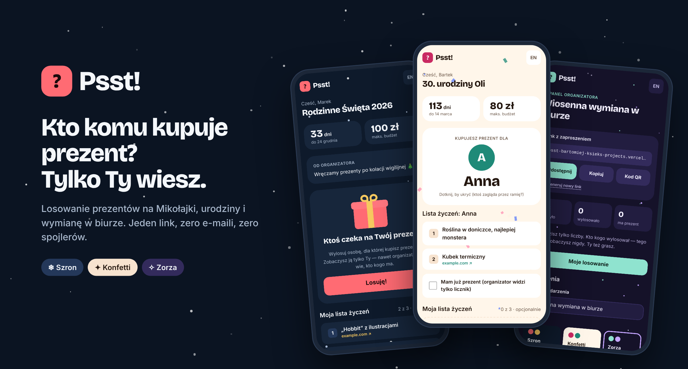
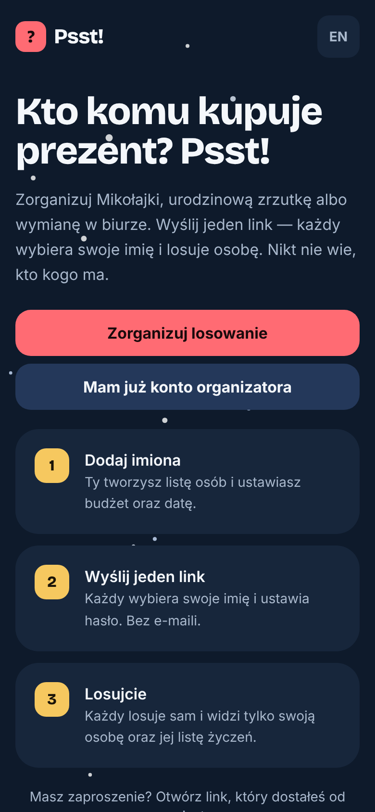
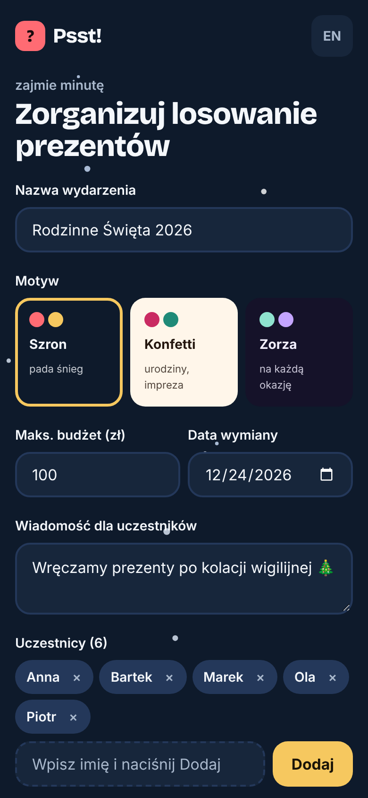
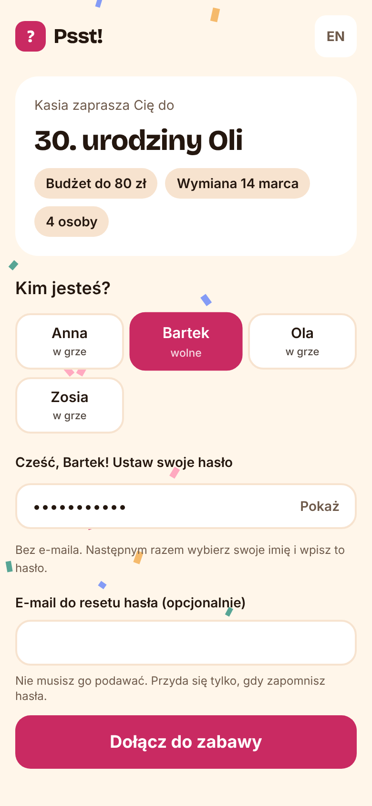
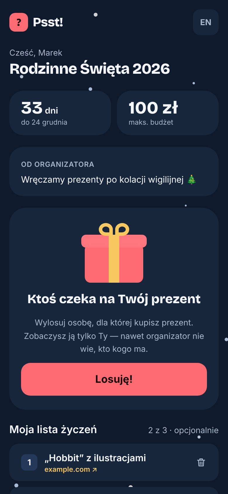
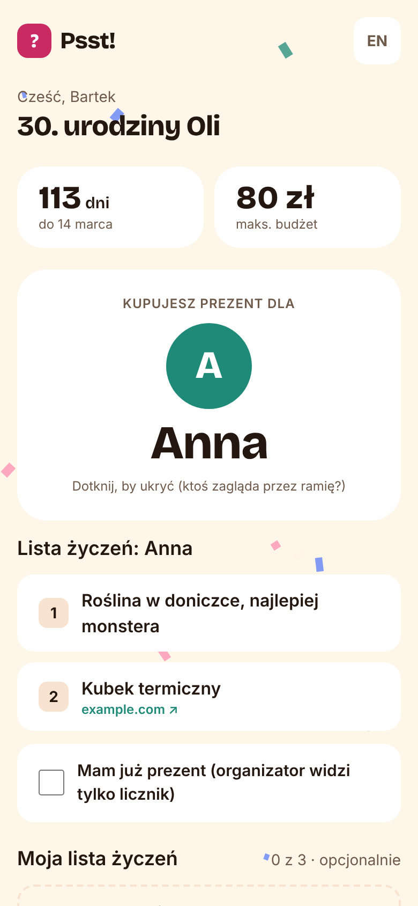
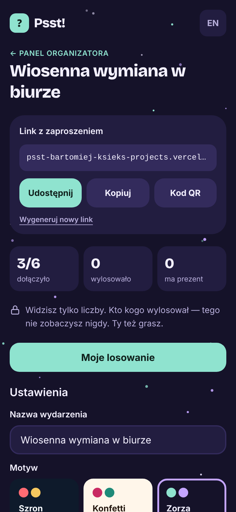

# Psst! 🤫🎁

**Kto komu kupuje prezent? Tylko Ty wiesz.** 
The gift draw for Secret Santa, birthdays and office swaps. 
One link. No emails. No spoilers.

[**▶ Open the live app**](https://psst-bartomiej-ksieks-projects.vercel.app) · 🇵🇱 Polski · 🇬🇧 English

---

## Why Psst!?

Most Secret Santa tools make everyone sign up with an email, send a dozen messages, and the organizer can still peek at who has whom. **Psst! does it differently:**

- 🔗 **One invite link.** Drop it into the family group chat or show the QR code at the office.
- 🙋 **Tap your name.** Everyone picks themselves from the list and sets a password. No email, no account.
- 🎲 **Draw it yourself.** The present wobbles, the lid pops off, and a name appears with confetti. Only you ever see it.
- 🙈 **Even the organizer can't peek.** Pairings are encrypted in the database; the organizer only sees counts.
- 📝 **Wishlists that help.** Up to 3 gift ideas with optional shop links, so nobody gets a fifth mug.

## Screens

<table>
  <tr>
    <td align="center" width="33%"> <b>Start</b> Explains it in 3 steps</td>
    <td align="center" width="33%"> <b>Create in a minute</b> Name, theme, budget, date, people</td>
    <td align="center" width="33%"> <b>Join from the link</b> Tap your name, set a password</td>
  </tr>
  <tr>
    <td align="center"> <b>Your dashboard</b> Countdown, budget, your wishlist</td>
    <td align="center"> <b>The reveal</b> Your match + their wishlist, tap to hide</td>
    <td align="center"> <b>Organizer panel</b> Invite, settings, people, only counts</td>
  </tr>
</table>

## Three moods, one app

Each event picks its own theme, and the whole app, including the animated background, follows it.

| | Theme | Feels like | Background |
|---|---|---|---|
| ❄️ | **Szron** (Frost) | Christmas, winter evenings | gently falling snow |
| 🎉 | **Konfetti** | birthdays, parties | tumbling confetti |
| ✨ | **Zorza** (Aurora) | any occasion, office swaps | twinkling stars |

Animations switch off automatically when the phone's *Reduce motion* setting is on.

## Everything it does

**For participants**
- Join with name + password, with an optional email for password resets
- Draw your person with a gift-box animation and confetti; hide or show the name with a tap
- Wishlist: up to 3 ideas, links optional
- „Mam już prezent”: tick it when you've bought the gift (the organizer only sees a count)
- Countdown, budget, a message from the organizer, add-to-calendar (.ics)
- Polish / English switch; install it on your home screen like an app

**For organizers**
- Create events in a minute and take part yourself
- Share the invite via the share sheet, copy or a QR code, or generate a new link
- Edit the name, theme, budget, date and message at any time
- Add or remove people and set exclusions (couples won't draw each other)
- Decide whether drawing may start before everyone has joined
- Someone forgot their password? Hand them a one-time reset link (or email it)
- Reset all draws, delete the event

## 🥚 Psst… easter eggs

- Tap the logo **5×** quickly to make it snow gifts.
- **Press and hold** the logo, or type the Konami code ↑↑↓↓←→←→BA, and a sleigh flies by.
- Type **„hohoho”** in a wishlist idea and the gift box sings.
- **Shake your phone** while your match is on screen for a confetti burst.

## Privacy & security

- **Nobody sees the pairs.** Who-drew-whom is encrypted with AES-256-GCM and only decrypted for the giver.
- **Fair draw.** It's done once, on the server, in a single transaction. Nobody ever gets themselves, exclusions are respected, and it prefers one big circle so people don't simply swap gifts.
- **Passwords:** Argon2id. Sessions are httpOnly cookies, rotated on login and revoked on password change.
- **Abuse limits:** rate limits on logins, joins and password resets; reset tokens are random, hashed and short-lived.
- **Locked-down pages:** wishlist links must be http(s), invite codes are unguessable, and strict security headers are set.

---

Made with 🎁. Psst… don't tell anyone who you drew.

